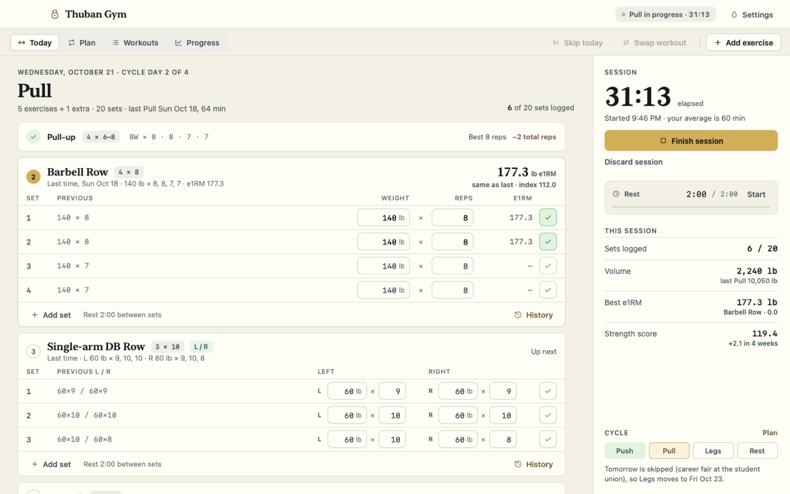
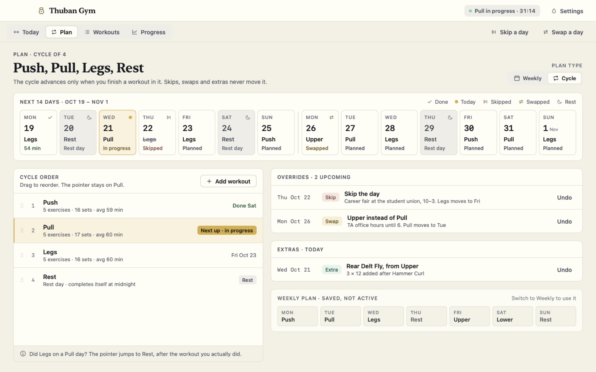
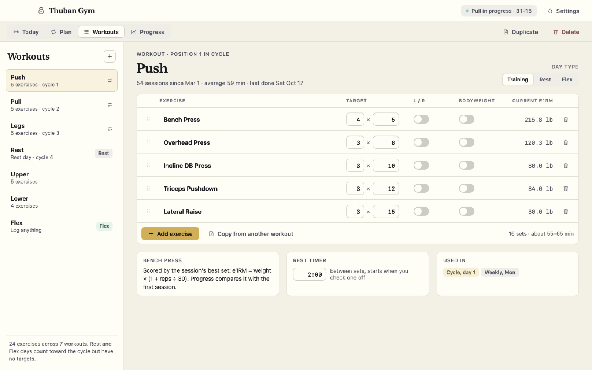
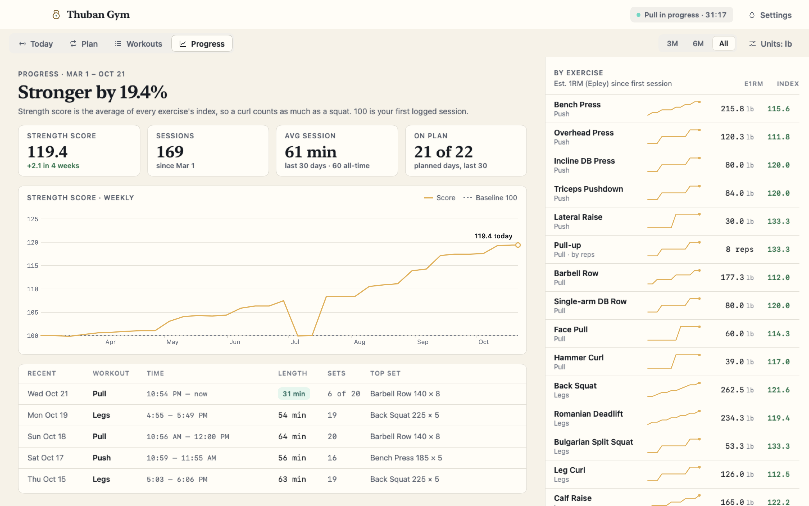
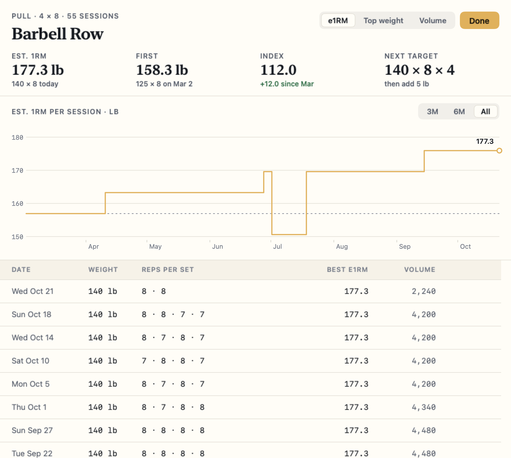
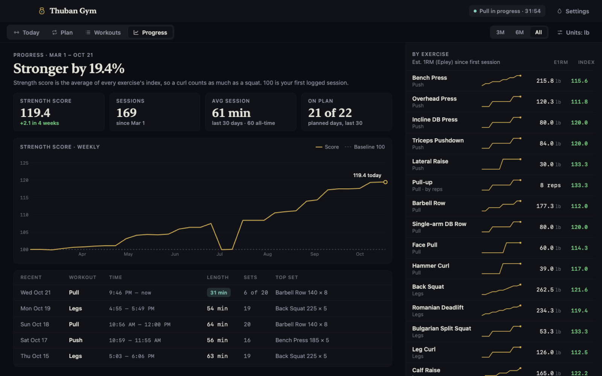
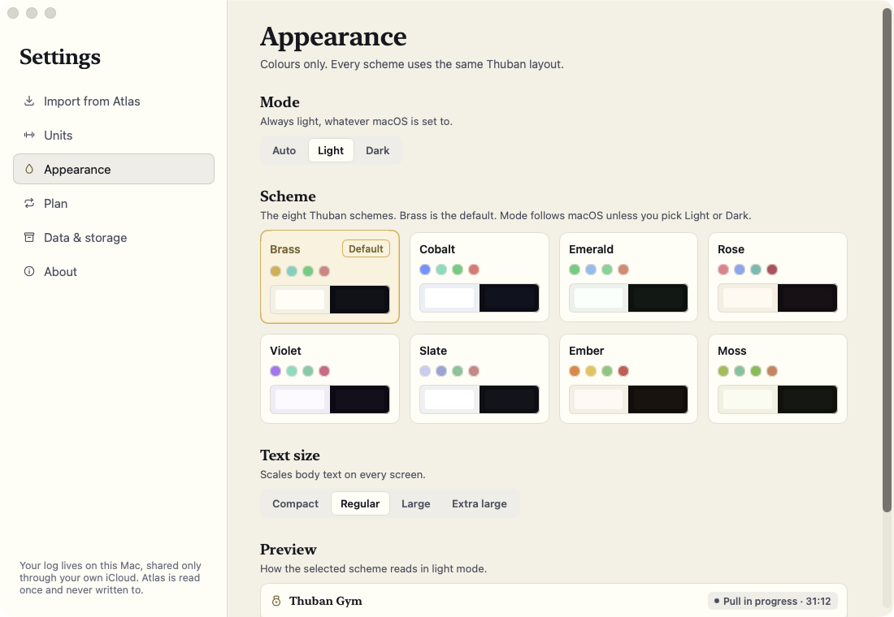

# Thuban Gym

A native SwiftUI workout planner and logger for macOS, iPhone and iPad, with private iCloud sync.



## Why

Most workout apps are either a phone-only logger or a spreadsheet. Thuban Gym is built around a training plan
that can be a fixed week **or** a rotating cycle (Push / Pull / Legs / Rest), and it handles real life: skip a
day, swap a workout, add an extra exercise, and the plan stays honest. Everything is stored in one local JSON
document you own, with no account and no server; iCloud sync is optional.

## Features

### Today and logging
- Today shows the planned workout, last time's numbers for every set, and the estimated 1RM as you log.
- Session timer, sets logged, volume vs. the last time you did that workout, and a rest timer that starts when you
  check off a set.
- Unilateral exercises log left and right side by side; bodyweight exercises are scored by reps.
- Skip today, swap the workout, or add an extra exercise for just one day.

### Programs and cycles
- Weekly plan (a workout per weekday) or a cycle of any length. The cycle only advances when you finish a workout
  in it; skips, swaps and extras never move it.
- A 14-day plan strip shows done, today, skipped, swapped and rest days ahead of time.
- Rest days in a cycle complete themselves at midnight; overrides and extras expire after 90 days.

### Workouts and exercises
- Workouts with ordered exercises, targets like `4 × 6–8`, unilateral and bodyweight flags, and a per-workout rest
  timer.
- Training, rest and flex day types; duplicate a workout or copy exercises from another one.
- "Used in" shows where each workout appears in the plan.

### History and progress
- Estimated 1RM (Epley) per session, an index against your first session, and a strength score that averages
  every exercise so a curl counts as much as a squat.
- Weekly strength-score chart (Swift Charts) over 3 months, 6 months or all time, with per-exercise sparklines.
- Per-exercise history sheet: e1RM, top weight or volume chart, every session's sets, and the next target.
- kg or lb display; storage is always kg and is never rounded by conversion.

### Data and sync
- One `gym.json` document, written atomically, with daily backups and labelled snapshots before an import or
  restore.
- Optional iCloud sync between Mac and iPhone through a hidden iCloud Documents container. Merging is per record
  (stable ids, timestamps and tombstones), so edits on both devices combine instead of overwriting each other.
- `gym.json` import and export, plus a one-time import from a legacy self-hosted Atlas database (read-only, Mac only).
- Eight colour schemes with auto, light and dark modes, and adjustable text size.

### iPhone and iPad
- A separate iOS target on the same core: tab-based Today, Plan, Workouts and Progress, a full-screen logging flow
  with the native number pad, quick ±2.5 / ±5 weight chips, and a rest screen.
- Rest-end local notifications and haptics, an optional keep-screen-awake mode, Dynamic Type.
- On iPad, a sidebar layout with the exercise list and the logger side by side.

## Screenshots

<table>
  <tr>
    <td></td>
    <td></td>
  </tr>
  <tr>
    <td align="center">Plan: cycle, 14-day strip, skips and swaps</td>
    <td align="center">Workouts and exercise targets</td>
  </tr>
  <tr>
    <td></td>
    <td></td>
  </tr>
  <tr>
    <td align="center">Progress: strength score and per-exercise e1RM</td>
    <td align="center">Exercise history and next target</td>
  </tr>
  <tr>
    <td></td>
    <td></td>
  </tr>
  <tr>
    <td align="center">Dark mode</td>
    <td align="center">Appearance settings</td>
  </tr>
</table>

Screenshots come from the app's automated smoke run on seeded sample data.

## Built with

- Swift and SwiftUI (macOS 15+, iOS 18+), Swift Charts
- A local Swift package, `ThubanGymCore`, for the model, rules, scoring, storage, import and sync
- iCloud Documents (`NSFileCoordinator` / ubiquity container) for sync
- XcodeGen (`project.yml`) to generate the Xcode project
- XCTest for the core; a scripted screenshot smoke run for the UI (macOS app and iOS Simulator)

## How it was built

Thuban Gym was designed and directed by the owner; the code was written with Claude Code (AI-assisted).

## Architecture

- **One value, one file.** `GymData` is a single Codable value saved as `gym.json`. A few thousand sets is well
  under 1 MB, so each change rewrites it atomically; backups are plain file copies.
- **Pure core.** Plan resolution, cycle advancement, rollover, scoring and session logic are pure functions in
  `Packages/ThubanGymCore`, unit-tested without a UI or database.
- **Thin apps.** The Mac and iOS apps share an `AppModel` surface and `Shared/` query and mutation extensions;
  every mutation saves immediately, so views never hold separate caches.
- **Conflict-free sync.** Records carry stable ids and `updatedAt` stamps; deletions are tombstones. The merge is
  commutative, associative and idempotent, so devices converge regardless of order.
- **Generated project.** The `.xcodeproj` is generated from `project.yml` on every build and never committed.

See [ARCHITECTURE.md](ARCHITECTURE.md) for the full design.

## Getting started

### Requirements

- macOS 15 or later (the iOS app targets iOS 18+)
- Xcode 26
- [XcodeGen](https://github.com/yonaskolb/XcodeGen) on your `PATH` (`brew install xcodegen`)

### Build and run (macOS)

```sh
scripts/test.sh        # core unit tests (swift test)
scripts/build.sh       # Debug build; regenerates the Xcode project first
scripts/smoke.sh       # build, run on seeded sample data, write screenshots to .build/smoke
scripts/install.sh     # Release build copied to /Applications/Thuban Gym.app
```

`scripts/regen.sh` regenerates `ThubanGym.xcodeproj` if you want to open it in Xcode. To try the app on sample data
without touching your own log:

```sh
THUBAN_GYM_HOME=/tmp/gym-demo THUBAN_GYM_SEED=sample \
  ".build/DerivedData/Build/Products/Debug/Thuban Gym.app/Contents/MacOS/Thuban Gym"
```

### iOS

```sh
scripts/ios_build.sh   # unsigned iOS Simulator build
scripts/ios_smoke.sh   # iPhone and iPad simulator screenshots on sample data
scripts/ios_install.sh # install on a simulator; a signed device build when an iPhone is paired and a team is set
```

### Signing and iCloud

Without a team, builds are ad-hoc signed (Mac) or unsigned (Simulator). They work fully, just without iCloud sync;
Settings shows sync as off. To enable iCloud sync, copy the example config and add your Apple Developer team ID:

```sh
cp Config/Signing.example.xcconfig Config/Signing.xcconfig
# edit DEVELOPMENT_TEAM = <your team id>
```

`Config/Signing.xcconfig` is gitignored. You can also pass `DEVELOPMENT_TEAM=<team id>` to any build script. With a
team set, the scripts sign automatically with the iCloud entitlements and let Xcode create the App IDs, the
iCloud container and the provisioning profiles for the Apple ID added in Xcode ▸ Settings ▸ Accounts.

## Part of Thuban

Thuban Gym is one app in a suite of native Mac apps that share one theme engine and colour scheme:

- [Thuban Study](https://github.com/ChancellorVerdery/thuban-study)
- [Thuban Graph](https://github.com/ChancellorVerdery/thuban-graph)
- [Thuban Canvas](https://github.com/ChancellorVerdery/thuban-canvas)
- [Thuban Desk](https://github.com/ChancellorVerdery/thuban-desk)
- [Thuban Planner](https://github.com/ChancellorVerdery/thuban-planner)

---

All rights reserved.
